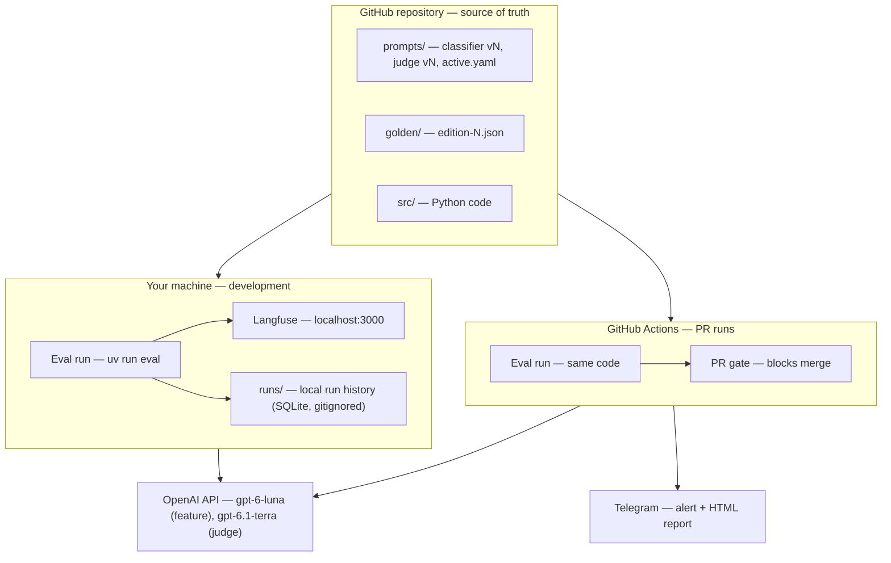
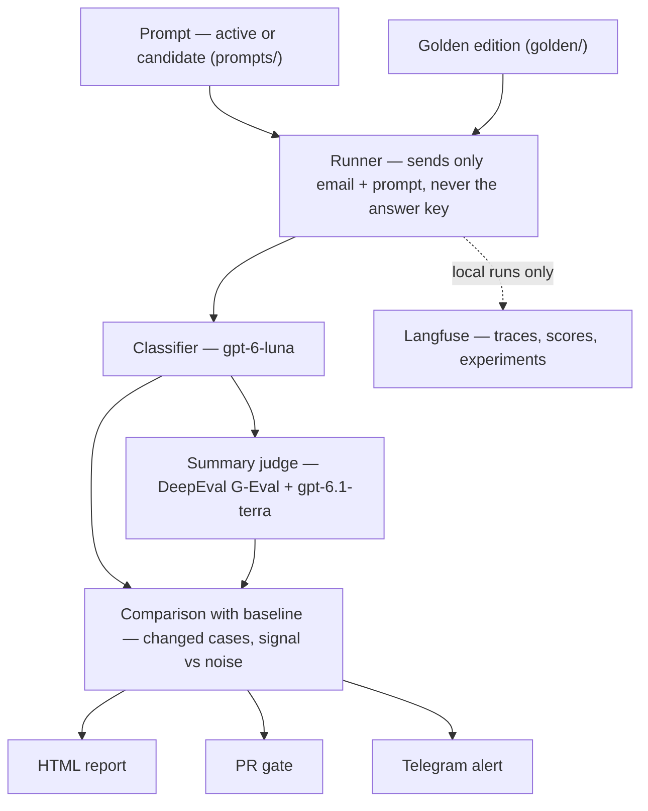

# Model Regression Detection System

> **Build sequence:** first project (no prerequisites) · **Guide reference:** BASWE guide, "Model Regression Detection System"
> **Difficulty:** lowest of the set · **No time estimates:** the work proceeds phase by phase

> **Documentation map.** This file is the source of truth. Each phase's
> decisions are explained, with their references, in [`phases/`](phases/);
> concepts and tool choices are in [`foundations.md`](foundations.md); manual
> procedures are in [`guides/`](guides/); summary rules are in
> [`summary-guide.md`](summary-guide.md); the approved build order is in
> [`implementation-plan.md`](implementation-plan.md). Agents start at the
> project [`CLAUDE.md`](../CLAUDE.md).

## 1. Goal

Build a **trustworthy measuring instrument for a non-deterministic LLM
feature** — a golden dataset, multi-dimensional scoring, an LLM judge, and a
comparison that separates real regressions from noise — and **enforce it as a
quality gate** on every PR that changes a prompt (blocks the merge on
critical regressions). There are no scheduled runs: the gate is an extra
validation layer at PR time.

Alerts go to Telegram with the HTML report attached.

The feature under test is a **customer support email classifier for a
fictional Brazilian marketplace**: it reads a customer email (in Portuguese)
and returns one of **7 categories** (taxonomy in section 4) plus a
one-sentence summary. The feature is **never deployed to production**:
every evaluation runs against the golden set, never live traffic.

## 2. Why it matters

Most teams ship prompt changes blind. The CI workflow itself is small; the
engineering is in the instrument — answering "what is the evaluation?", "how
do we score an open-ended summary?", "is a 2-point drop real or noise?",
"which cases regressed?" and "what if the model changed under us?". CI only
makes the check mandatory, reproducible and visible to reviewers. The
instrument is also the **foundation for every other project** — the eval
runner, scoring and diff logic built here are reused in
`hybrid-rag-pipeline`, `lora-fine-tuning-pipeline`, `eval-dataset-generator`
and `agent-orchestration-system`.

## 3. Tech stack

| Component | Guide | Our choice | Cost |
|---|---|---|---|
| Language | Python 3.11+ | Python 3.12 + `uv` | Free |
| LLM (feature under test) | OpenAI gpt-4o / gpt-4o-mini | `gpt-6-luna` ($0.10 / $0.50 per 1M tokens, `reasoning.effort=none`); model ID set in the prompt YAML | Paid — OpenAI credits |
| LLM-as-judge | (implicit) | `gpt-6.1-terra` ($1 / $5 per 1M tokens, `reasoning.effort=none`, temperature 0); model ID set in the judge's versioned config (Phase 3). Single judge, no second provider | Paid — OpenAI credits |
| LLM API | — | OpenAI **Responses API** (`responses.parse` with Pydantic `text_format`), isolated inside the `OpenAIClient` adapter | — |
| Eval framework | Custom + RAGAS or DeepEval | **DeepEval** (open source, Apache 2.0; runs locally and in CI with no account): G-Eval metric for the summary judge. Runner, baseline comparison, signal vs noise and the PR gate are our code — no market tool covers them | Free |
| Observability | — | **Langfuse** (open source, MIT core), self-hosted **locally** with Docker Compose (`localhost:3000`): golden edition as a dataset, prompt versions, one trace per case, scores, experiments side by side. Local runs only; CI uses a no-op tracer | Free |
| Typed contracts | Pydantic | Pydantic v2 | Free |
| Storage | SQLite + JSON | SQLite (runs, scores) + versioned JSON (golden set) | Free |
| Alerting | Slack webhooks | Telegram Bot API (`sendDocument`: HTML report as the file, summary as the caption; decision 4.2) behind a `Notifier` port — Slack/Discord can be added as new adapters | Free |
| CI | GitHub Actions | GitHub Actions on a **public** repo | Free |
| Reporting | Streamlit or HTML | Static HTML report (Jinja2): uploaded as a CI artifact and sent as a file in the Telegram alert. No web layer | Free |
| Containerization | Docker | Dockerfile to run the eval locally without installing Python or uv (decision 5.3); CI runs directly with uv from the same `uv.lock`; the image is not published | Free |

### Generation parameters (terminology and provider constraints)

Three different things, never mixed up in code, docs or YAML keys:

| Term | What it is | Set by | Touched here? |
|---|---|---|---|
| **Model parameters** | The network weights learned in training | Training | No (frozen behind the API) |
| **Training hyperparameters** | Settings that control training (learning rate, batch size, epochs, LoRA rank) | A human, before training | No (that is `lora-fine-tuning-pipeline`) |
| **Generation parameters** (a.k.a. sampling / decoding parameters) | How each output token is drawn from the trained model's distribution: `temperature`, `top_p`, output token limit, reasoning effort | The caller, per request | **Yes** — grouped under the `generation` key of each prompt YAML |

`temperature` divides the logits before the softmax: it changes how often a
non-top token is sampled, never what the model knows. Even at `temperature: 0`
providers do not guarantee determinism.

Provider constraints checked on 2026-11-03:

- **OpenAI (GPT-6 guide):** `temperature`, `top_p` and `top_logprobs` are only
  accepted when `reasoning.effort` is `none`. `gpt-6-luna` and `gpt-6.1-terra`
  support `none`. The prompt loader must reject `temperature` combined with
  any other effort level.
- **Gemini 3:** Google strongly recommends keeping `temperature` at its
  default 1.0. (Not used in this project.)
- **Anthropic:** Claude Opus 4.7 rejects non-default sampling values, and API
  version `2026-10-21` rejects `temperature` / `top_p` / `top_k` even at
  default values. (Not used in this project.)

## 4. Data

- **Golden dataset: ~140 hand-written, human-verified cases (~20 per
  category).** The guide is explicit: do *not* generate them with an LLM —
  the human labeling is the interview story.
- Public datasets are used only as **inspiration for realistic wording and
  category balance**, never copied as labels:
  - `bitext/Bitext-customer-support-llm-chatbot-training-dataset` (Hugging Face; CDLA-Sharing-1.0)
  - `Tobi-Bueck/customer-support-tickets` (Hugging Face; CC BY-NC 4.0; origin
    not stated — do not copy)
  - Other implementations of the same BASWE project exist on GitHub; none has
    a license, so their golden sets are references for structure only.

### Category taxonomy

Scope: the sender is always the **buyer**; seller emails are out of scope
(a misrouted seller email is a `general` edge case). The Portuguese wording
of each definition lives in the classifier prompt (`prompts/classifier/vN.yaml`); the
label values are the enum in code.

| Label | One-sentence definition |
|---|---|
| `delivery` | The customer asks about an order not yet received: where it is, delay, tracking, lost parcel or delivery address. |
| `cancellation` | The customer wants to give up an order they have not received yet. |
| `return_refund` | The customer wants to return or exchange something they received (defect, not as described, regret), or chases the money back from a return or cancellation. |
| `payment` | The problem is the payment itself: declined payment, duplicate or wrong charge, Pix, boleto, card, instalments or invoice (nota fiscal). |
| `account` | The problem is the customer's account: access, password, profile data, blocked account or security. |
| `technical` | The app or website fails and blocks the customer: crash, page not loading, button not working, error screen at checkout. |
| `general` | Anything that is not an action on an order or on the account and not a malfunction: how the platform works, coupons, suggestions, compliments. |

**Master rule:** classify by the **main action the customer requests**, not by
the context they tell. Secondary requests may go into `acceptable_categories`.

| Pair | Tie-break rule | Example |
|---|---|---|
| `cancellation` × `return_refund` | Not received yet → `cancellation`; already received → `return_refund` | "I want to cancel, but it arrived yesterday" → `return_refund` |
| `delivery` × `cancellation` | Asks to cancel → `cancellation`; only complains or asks about the delay → `delivery` | "10 days late, please cancel" → `cancellation` |
| `delivery` × `return_refund` | Not delivered / lost → `delivery`; delivered with a problem → `return_refund` | "It arrived broken" → `return_refund` |
| `return_refund` × `payment` | Money back from a return/cancellation → `return_refund`; wrong charge with no return → `payment` | "I cancelled and the refund never came" → `return_refund`; "charged twice" → `payment` |
| `account` × `payment` | Access, data or security of the account → `account`; the transaction itself → `payment` | "My account was blocked after a purchase" → `account` |
| `technical` × `payment` | The app/site breaks (error screen, button does nothing) → `technical`; the payment is processed and declined or wrong → `payment` | "Checkout shows an error and won't finish" → `technical`; "my card was declined" → `payment` |
| `technical` × `account` | Cannot log in because of password, block or data → `account`; the login page or app itself fails → `technical` | "The app closes when I open the login screen" → `technical` |

### Golden file
- **Language of the data: Brazilian Portuguese.** This is a Brazilian
  support product: emails, expected summaries and notes are written in
  Portuguese; only the category label values (`delivery`, …) and the JSON keys
  are in English. **~10 % English or mixed EN/PT emails** are kept as an edge
  case. The summary is always written in Portuguese.
- File layout (`golden/edition-N.json`; the draft lives in
  `golden/drafts/edition-1.json` until frozen): a header (`edition`,
  `status` draft/frozen, `created_at`, `categories`, `quality_checks` with
  the label-audit and intra-annotator results) plus a `cases` list. Each
  case:

  | Field | Meaning | Filled by |
  |---|---|---|
  | `id` | Stable, readable ID (`delivery-001`); never renumbered, never reused | Claude |
  | `input_email` | The customer email (PT) | Luis |
  | `expected_category` | Correct queue (English label) | Proposed by the case brief, confirmed by Luis |
  | `acceptable_categories` | Ambiguous cases only: other labels that also count as correct | Luis |
  | `expected_summary` | Ideal one-sentence summary (PT) | Luis |
  | `expected_difficulty` | `easy` / `medium` / `hard` | Suggested by Claude, confirmed by Luis |
  | `case_type` | `typical` / `edge` / `adversarial` / `known_failure` (coverage bucket, decision 2.1) | Claude, from the brief |
  | `language` | `pt` / `en` / `mixed` (metadata for slicing, not a category) | Claude |
  | `edge_types` | List of edge / adversarial types from decision 2.2 (empty for most `typical` cases) | Claude, from the brief |
  | `notes` | Why the case exists (PT) | Drafted by Claude, reviewed by Luis |

- **Coverage matrix, golden edition 1** (decision 2.1) — per category, the
  same for all 7:

  | Case type | Per category | Total | Share | What it tests |
  |---|---|---|---|---|
  | `typical` | 14 | 98 | 70 % | Happy path, varied customer profiles (formal, informal/slang, angry, low digital literacy) |
  | `edge` | 4 | 28 | 20 % | Edge types from decision 2.2 |
  | `adversarial` | 2 | 14 | 10 % | Prompt injection in the email, attempts to force a category, unrelated content |
  | `known_failure` | 0 | 0 | — | Starts empty; real failures become candidates for edition 2 |
  | **Total** | **20** | **140** | | |

  Cross-cutting: ~10 % English/mixed in every case type (~14 cases);
  at least 25 % `hard` (≥ 35 cases).

  Exact targets (counts per category and case type, each edge type at least
  twice, the adversarial subtypes, ≥ 35 `hard`) are flags that block
  freezing. Approximate targets (the ~10 % English/mixed share and the
  difficulty mix per case type) are printed by the validation script as
  information, never as flags (decided 2026-11-05). Known limitation of
  edition 1: language is confounded with the adversarial subtype — all
  `label_forcing` cases are English, all `prompt_injection` cases are
  Portuguese, and 7 of the 9 English cases are adversarial — so the language
  slice and the adversarial-subtype slice cannot be told apart. Slices are
  advisory, so the gate verdict is unaffected.
- **Edge and adversarial types** (decision 2.2), values of `edge_types`:

  | Type | Definition | Basis |
  |---|---|---|
  | `ambiguous` | Fits two categories; the tie-break rule decides (often has `acceptable_categories`) | Our tie-break rules |
  | `temporal` | Timing changes the category (received or not; cancelled before or after) | CheckList — temporal |
  | `negation` | A negation flips the apparent meaning | CheckList — negation |
  | `confounder` | Uses another category's vocabulary, but the request clearly belongs to one | CheckList — vocabulary |
  | `multiple_requests` | More than one request; the main action decides | Master rule |
  | `very_short` | One to five words | Apple — very short inputs |
  | `long_thread` | Long or forwarded email, quoted history or signature, request buried inside | Apple — unusual formatting |
  | `typos` | Heavy typos, abbreviations, no punctuation | CheckList — robustness |
  | `sarcasm` | Real meaning is the opposite of the literal one | BASWE guide |
  | `mixed_language` | Portuguese and English mixed; counts toward the ~10 % EN/mixed | Language decision |
  | `prompt_injection` (adversarial) | Instructions to the classifier inside the email, including fake JSON; correct answer = the real request | OWASP LLM01 |
  | `label_forcing` (adversarial) | Customer tries to force the routing; correct answer = the real request | OWASP LLM01 |
  | `out_of_scope` (adversarial) | Not a buyer support request (spam, ads, misrouted seller email); correct answer = `general` | CLINC150 out-of-scope |

  Distribution: every edge type appears at least twice among the 28 edge
  cases; `ambiguous`, `temporal` and `negation` concentrate on the hard
  boundaries (`cancellation` × `return_refund` × `delivery`, `technical` ×
  `account`); a case may carry more than one type. Adversarial: two per
  category (`prompt_injection` or `label_forcing` with that category as the
  real request), except `general`, whose two are `out_of_scope`.
  Future: CheckList-style invariance tests (code-generated perturbations of
  typical cases that must keep the label).
- **Difficulty rubric** (decision 2.3), based on observable features of the
  email, not on feeling:

  | Level | The email has… |
  |---|---|
  | `easy` | One clear, explicit request using the category's own vocabulary; no tie-break rule involved |
  | `medium` | A clear request that needs reading: indirect or informal wording, slang, longer text, one distracting word, or one tie-break rule applied directly |
  | `hard` | The correct answer depends on a hard mechanism: timing, negation, sarcasm, ambiguity resolved only by a tie-break rule, multiple requests with a non-obvious main action, heavy noise in a short text, or an adversarial case. Practical test: an attentive human agent would hesitate |

  `typical` cases are mostly `easy`/`medium`; `edge` mostly `medium`/`hard`;
  `adversarial` almost always `hard`. At least 35 `hard` cases. After the
  first runs, the **observed difficulty** of each case (how often it fails
  across prompt versions) is computed from the local run history (SQLite,
  not stored in the golden file) and a local analysis flags mismatches with
  the expected difficulty — inputs for golden edition 2. It is not part of
  the PR report (decision 4.1).
- **Summary guide** (decision 2.4): every `expected_summary` follows
  [`summary-guide.md`](summary-guide.md) — one Portuguese sentence, main
  request + essential fact, only facts stated in the email, concrete details
  kept, category never named, neutral tone, ~25 words target, adversarial
  and English/mixed rules. The same guide feeds the classifier prompt and the
  judge rubric.
- **Duplicate detection** (decision 2.6), within the golden set and between
  the golden set and the few-shot examples:

  | Layer | Method | Rule |
  |---|---|---|
  | Exact | Hash of normalized text (NFKC, casefold, no punctuation, collapsed whitespace) | Match blocks |
  | Lexical | `rapidfuzz.token_sort_ratio` (not `token_set_ratio`, which scores 100 when one text is contained in the other) | ≥ 90 blocks; 80–90 warns; texts under 5 words only get the exact check |
  | Semantic | Cosine similarity of OpenAI embeddings (model ID confirmed at implementation, kept in config) | ≥ 0.92 warns for review |
  | Label conflict | Any lexical or semantic pair with different `expected_category` | Highest-priority flag: fix a label or explain the difference in `notes` |

  Starting thresholds come from published practice (TF-IDF cosine 0.9
  conservative; embedding cosine 0.85–0.95) and are checked against a
  crafted fixture of pairs in unit tests, never tuned on the golden set.
- Statistical limit: 140 cases cannot reliably detect small differences
  (Apple's guidance: ~400 samples for a 5-point difference at 95 %
  confidence, independent samples). Large regressions (≈ 8+ points) are
  detectable; small ones are warnings, and cumulative small drops are caught
  by the absolute floor (decision 3.4). Our
  comparison is paired, which is more sensitive; the method is decided in
  Phase 3.
- Category scoring is three-way: **exact** (matches `expected_category`),
  **acceptable** (matches one of `acceptable_categories`), **miss**.
- `expected_difficulty`, `language` and `edge_types` do not affect the score;
  they slice the scorecard (e.g. "v2 regressed only on `hard` + `sarcasm`").
- Version the dataset file (`golden/edition-1.json`, `edition-2.json`, …); an edition is
  frozen once published and every eval run records which version it used.
  Real failures found later become candidates for the next version.

### Naming conventions

Two things are versioned, and they never share a name:

| Thing | What it is | File | How it is referred to (reports, PR comments, docs) |
|---|---|---|---|
| **Prompt version** | The instructions sent to a model; changes whenever the classifier is improved | `prompts/classifier/v3.yaml` (judge: `prompts/judge/v1.yaml`) | "classifier prompt v3", "judge prompt v1" |
| **Golden set edition** | The exam with the answer key; changes rarely | `golden/edition-1.json` | "golden edition 1" |

- `active.yaml` points to the **active** prompt version (the official one);
  a new version under review in a PR is a **candidate**.
- The **baseline** is the last approved run on `main`.
- A run is always described as: *classifier prompt v3 (candidate) vs
  classifier prompt v2 (baseline), golden edition 1*.

## 5. Compute requirements

- **CPU only.** Any laptop works. No GPU, no Colab.
- One eval run ≈ 140 feature calls + ~700 judge calls (5 checklist items
  per case) ≈ $0.02 (feature, `gpt-6-luna`) + ~$0.65 (judge,
  `gpt-6.1-terra`) ≈ $0.75 per run (estimate, Nov 2026 prices).
- CI minutes: a run should finish in < 3 minutes using async batching.

## 6. Architecture

### Where things live



### One eval run (same code locally and in CI)



Legend: our code = runner, comparison, gate; market tools = OpenAI, DeepEval,
Langfuse, Telegram; files = prompts and golden editions in git.

### Application flows

**Flow 0 — setup (once)**
1. `docker compose up` (Langfuse, local); create a project in the UI and put
   its keys in the local `.env`.
2. Write golden edition 1 (case briefs → Luis writes email + summary →
   Claude structures JSON → Luis confirms); freeze `golden/edition-1.json`.
3. One-way copy of the golden edition into Langfuse as dataset
   `golden-edition-1` (input = email, expected output = category + summary).
4. Write classifier prompt v1 from the approved taxonomy; `active.yaml`
   points to v1.
5. The runner registers classifier prompt v1 in Langfuse (one-way copy,
   label `active`). Prompts are never edited in the Langfuse UI.
6. The baseline is always the active prompt on `main`, re-run next to the
   candidate in the same PR job (decision 3.6); nothing needs to be stored for
   the gate.

**Flow 1 — developing a candidate prompt locally**
1. Load the candidate (e.g. classifier prompt v2) and golden edition 1;
   validate labels against the enum and the temperature/effort rule. The
   candidate is registered in Langfuse as a new prompt version.
2. Open a Langfuse experiment on `golden-edition-1`
   (e.g. `classifier-v2 · <timestamp>`).
3. For each case: send only email + prompt to `gpt-6-luna`; get
   `{category, summary}`. Langfuse records one trace per case (prompt
   version, input, output, tokens, cost, latency), linked to its dataset item.
4. Score the category (exact / acceptable / miss) in our code → score
   `category_match` on the trace.
5. Score the summary with the judge (DeepEval G-Eval, `gpt-6.1-terra`) → the
   judge call is nested in the same trace; score `summary_score`.
6. Compare with the baseline (our code). Langfuse does not decide; it lets
   you put the candidate's experiment next to the baseline's, case by case.
7. Outputs: HTML report + console alert. Iterate until satisfied.

**Flow 2 — pull request**
1. The PR adds `prompts/classifier/v2.yaml` and points `active.yaml` to it.
2. Because the PR changes an eval-relevant path (`prompts/**`,
   `config/gate.yaml` or the eval workflow, decision 5.1), GitHub Actions
   runs the same eval (Flow 1, steps 1–6) with `NoopTracer`,
   on **both** sides in the same job: classifier prompt v2 (candidate) vs
   classifier prompt v1 (baseline, the active prompt on `main`), golden
   edition 1. Cases are paired by `id` (decision 3.6).
3. Outputs: PR comment, HTML report artifact, Telegram alert with the report.
4. Gate (decisions 3.4–3.5): `blocked` or `inconclusive` → check fails,
   merge blocked; `passed` / `warning` → merge allowed. After the merge, v2 is
   the active prompt on `main`, so it is the baseline of the next PR.
5. Next local run moves the Langfuse `active` label to v2.

### Ports and adapters

The core (feature, eval, compare, report) never imports a vendor SDK. It
depends only on **ports** — `typing.Protocol` interfaces it owns. Each external
system is reached through an **adapter** that implements a port. Swapping a
vendor means writing a new adapter and changing the wiring, not the core.

| Port (core-owned interface) | Adapters (now) | Adapters (possible later) |
|---|---|---|
| `LLMClient` — one async `complete(LLMRequest) -> LLMResult` (decision 1.5): parsed output, raw text, status, served model ID, token usage, latency, provider request ID | `OpenAIClient`, `CachingLLMClient` (wraps another client; Phase 3) | Another provider's client, if ever needed |
| `Notifier` — send a run summary (status, headline numbers) with the HTML report attached | `TelegramNotifier`, `ConsoleNotifier` (local runs / tests) | `SlackNotifier`, `DiscordNotifier` |
| `RunRepository` — save/load runs and per-case results | `SQLiteRunRepository` | Postgres |
| `Tracer` — record a run as an experiment: one trace per case (prompt version, input, output, tokens, latency) plus its scores | `LangfuseTracer` (local runs), `NoopTracer` (CI and tests) | Langfuse Cloud, if CI traces are ever wanted |

Adapters are chosen in a single composition root (`config.py` / CLI entry
point) from environment variables, e.g. `NOTIFIER=telegram|console`,
`TRACER=langfuse|noop`. Tests use
in-memory fakes of each port, so the core is tested without network calls.

Proposed layout:

```
src/regression_detector/
  ports/          # Protocols: LLMClient, Notifier, RunRepository, Tracer
  adapters/       # openai_client, telegram_notifier, console_notifier,
                  # sqlite_repository, langfuse_tracer, noop_tracer
  feature/        # classifier + PromptConfig
  prompts/        # loader for versioned YAML
  eval/           # runner, scorers, judge
  compare/        # diff, thresholds, signal vs noise
  report/         # HTML templates (Jinja2)
  config.py       # settings from env vars + adapter wiring (composition root)
prompts/
  classifier/     # v1.yaml, v2.yaml ... (classifier prompt versions)
  judge/          # v1.yaml ... (judge prompt versions, Phase 3)
  active.yaml     # which version of each prompt is active
golden/           # edition-1.json, edition-2.json ... (drafts/ until frozen)
calibration/      # judge calibration set: summaries.json, labels.json (Phase 3)
config/           # pricing.yaml (model prices, date checked);
                  # gate.yaml (thresholds, absolute floor, golden edition in use)
infra/langfuse/   # docker-compose.yml for the local Langfuse
.github/workflows/eval.yml
```

## 7. Build plan

### Phase 1 — Feature under test
- [ ] Classifier function with the prompt as a configurable parameter.
- [ ] Versioned prompts in `prompts/` (YAML layout from decision 1.2), with
      a loader that validates labels against the enum and rejects
      `temperature` with a reasoning effort other than `none`.
- [ ] `PromptConfig` and output models in Pydantic; structured JSON output.
- [ ] 7 static few-shot examples in classifier prompt v1 (one per category,
      typical `easy` cases, Portuguese), drafted by Claude and approved by
      Luis in the prompt's PR (decision 1.4).
- [ ] `LLMClient` port (`LLMRequest` / `LLMResult`, decision 1.5) +
      `OpenAIClient` adapter so another provider could be plugged in later
      without touching the feature.
- [ ] `config/pricing.yaml` (price per model, date checked) and cost
      computation per call.
- [ ] Failure handling in `OpenAIClient` (decision 1.6): SDK retries
      (`max_retries=4`, 60 s timeout per call); config errors (400/401/404)
      abort the run; refusal / incomplete / invalid output mapped to
      `LLMResult.status`, never retried.
- [ ] Local Langfuse via Docker Compose (`infra/langfuse/`); keys in the
      local `.env` (`LANGFUSE_PUBLIC_KEY`, `LANGFUSE_SECRET_KEY`,
      `LANGFUSE_HOST`).
- [ ] `Tracer` port + `LangfuseTracer` / `NoopTracer` adapters; every
      classifier call becomes a trace linked to its prompt version (prompt
      registered one-way in Langfuse; its `active` label mirrors `active.yaml`).

### Phase 2 — Golden dataset
- [x] Coverage matrix approved by Luis (cases per category × difficulty ×
      edge type × language) before any case is written.
- [ ] Authoring loop, one case at a time: Claude sends a case brief ("this
      category means X; scenario, tone, length, edge type"); Luis writes the
      email and the summary in Portuguese; Claude structures the JSON case and
      shows it back; Luis confirms label and difficulty.
      Status 2026-11-04: 140 cases drafted in `golden/drafts/edition-1.json`;
      review items R1–R5 in `golden/drafts/review-notes.md` resolved the same
      day; coverage targets met. Next: validation script, label audit,
      intra-annotator check, freeze.
- [ ] Pydantic schema + validation script: unique IDs, labels in the enum,
      matrix balance (2.1, 2.2, 2.3; exact targets flagged, approximate
      targets shown as information), duplicate detection (2.6) within the
      golden set and between the golden set and the prompt's few-shot
      examples (1.4); runs locally and in CI whenever `prompts/` or
      `golden/` change.
- [ ] Unit-test fixture of crafted text pairs (must / must not be flagged)
      to check the duplicate thresholds — never tuned on the golden set.
- [ ] Label audit (decision 2.5): `gpt-6.1-terra` with 3 prompt variants
      re-labels every case; cases where the 3 agree with each other and
      disagree with Luis's label are flagged; Luis resolves each flag (keep /
      relabel / add `acceptable_categories` / rewrite) and records the reason
      in `notes`. The LLM never writes a label.
- [ ] Intra-annotator check (decision 2.5): days later, Luis blindly
      re-labels 20 random cases (~15 %); Cohen's kappa ≥ 0.7 required,
      otherwise revise taxonomy definitions / tie-break rules before freezing.
- [ ] Freeze as `golden/edition-1.json` only when validation passes, all
      audit flags are resolved and kappa ≥ 0.7; the header records the
      taxonomy and summary-guide versions and the audit date.
- [ ] One-way copy of the frozen edition into a Langfuse dataset
      (`golden-edition-1`).

### Phase 3 — Evaluation engine
- [ ] Async test runner with concurrency limit (retries come from the SDK,
      decision 1.6).
- [ ] Run validity (decision 1.6): infrastructure errors above 2 % of cases
      make the run **inconclusive** (no verdict, never a baseline, distinct
      message in the PR check and Telegram); below that, errored cases are
      excluded from both sides of the comparison and listed. Judge failures
      give a missing score (not zero) and count toward the same limit;
      DeepEval configured not to halt the run on a metric error.
- [ ] Re-running after an inconclusive run only spends calls on failed
      cases, because the cache holds only completed calls.
- [ ] Multi-dimensional scoring: category (exact / acceptable / miss),
      summary quality (decision 3.2), latency, token usage, cost — stored
      per case.
- [ ] Summary judge (decision 3.2): deterministic checks in code (one
      sentence, starts with "Cliente", no category label, Portuguese), then
      a binary checklist judged item by item by `gpt-6.1-terra` (one DeepEval
      `GEval` per item, explicit `evaluation_steps`, binary via
      `strict_mode` — confirm against the current DeepEval version, fallback
      `DAGMetric`), reference-guided (email + expected summary + generated
      summary), evidence recorded per item; judge config versioned in
      `prompts/judge/v1.yaml` (Portuguese).
- [ ] Classification metrics (decision 3.1): strict accuracy (exact label)
      and acceptable accuracy (exact or in `acceptable_categories`);
      per-category precision / recall / F1 and macro-F1 on strict labels via
      scikit-learn `classification_report`; 7×7 confusion matrix plus a
      "no answer" column (refusal / incomplete / invalid); strict and
      acceptable accuracy sliced by `case_type`, `expected_difficulty`,
      `edge_types` and `language`, always shown with the slice size.
- [ ] Judge calibration (decision 3.3, guide `docs/guides/judge-calibration.md`):
      100 generated summaries (60 from classifier prompt v1, 40 from a
      deliberately degraded prompt) judged by Luis (overall pass/fail,
      `faithful`, `main_request`, short critique on fails); split 15 train /
      45 dev / 40 test; TPR ≥ 0.85 and TNR ≥ 0.85 on test, plus Cohen's kappa
      and verdict flip rate over 3 runs; report versioned in `docs/`.
      Optional: PT vs EN judge prompt compared on dev.
- [ ] Each local run recorded as a Langfuse experiment on the golden
      dataset, with `category_match` and `summary_score` on each trace.
- [ ] Baseline (decision 3.6): the PR job runs the active prompt on `main`
      and the candidate side by side; cases paired by `id`.
- [ ] Per-case diff (decision 3.6): headline table (baseline, candidate,
      delta in pp, regressions, improvements) for category, format and
      summary (summary marked advisory); lists ordered by severity
      (violated invariants, category, format, summary regressions,
      improvements, exact→acceptable changes, excluded infra errors); each
      case with `id`, expected category, label before → after, summary
      before → after, judge evidence; per-category and slice deltas with n
      (rows with a net drop ≥ 2 cases highlighted, verdict unchanged); count
      of cases whose output changed without a verdict change.
- [ ] Gate rules (decisions 3.4–3.5), thresholds in versioned config
      (`config/gate.yaml`, decision 5.1):
      per-case `category_pass` / `format_pass` / `summary_pass`; net drop =
      regressions − improvements (cases); `warning` at a net drop ≥ 5 cases
      (≈ 3.5 pp); `blocked` at a net drop ≥ 7 cases (5 pp) in `category_pass`
      or `format_pass`, any adversarial pass→fail, or below the absolute
      floor (value set after the first v1 run); `inconclusive` on infra
      errors > 2 %; exit codes 0 / 0 / 1 / 2. The judge is always advisory.
- [ ] "Nothing changed" check (decision 3.5): once, when classifier prompt
      v1 exists, run it 3 times (cache bypassed); confirm no threshold fires
      and no adversarial case flips; report in `docs/noise-check/`. Repeat
      only if the model changes.
- [ ] Response cache keyed by (prompt version, model, input hash) to avoid
      paying twice for identical calls during development, implemented as a
      `CachingLLMClient` adapter wrapping `OpenAIClient`.
- [ ] Judge calls go through `LLMClient` via a DeepEval custom-model adapter
      (confirm the integration against the current DeepEval version).
- [ ] `RunRepository` port + `SQLiteRunRepository` adapter (runs,
      case_results, golden edition used by each run).

### Phase 4 — Alerting and reporting
- [ ] Self-contained HTML report (decision 4.1; Jinja2 with
      `select_autoescape`, inline CSS, no JS, no external links), sections in
      order: verdict header (rule fired, versions + `change_note`, golden
      edition, judge prompt, served models, judge calibration status);
      headline table with thresholds and distance to the absolute floor;
      cases by severity in collapsible blocks (email included); per-category
      and slice deltas with n; classification detail and confusion matrix;
      prompt diff; cost and run configuration. No trend chart.
- [ ] PR comment rendered from the same data: verdict header, headline
      table, first 5 cases, pointer to the full report (posting in Phase 5).
- [ ] Unit tests: section order, `<script>` escaped, "floor not set yet",
      "no verdict" on inconclusive, at most 5 cases in the PR comment.
- [ ] `Notifier` port + `TelegramNotifier` adapter (decision 4.2): one Bot
      API `sendDocument` per run, HTML report as the file, summary as the
      caption (`parse_mode=HTML`, ≤ 1024 characters: verdict, versions, rule
      fired, headline table, context line, top 3 cases, cost, PR link);
      `passed` sent silently (`disable_notification`); a Telegram failure never
      changes the exit code. `ConsoleNotifier` prints the same summary and
      the report path for local runs.
- [ ] Unit tests: caption ≤ 1024 in the worst case, silent only on `passed`,
      escaping, no table on `inconclusive`, Telegram failure keeps the exit
      code, console output matches.

### Phase 5 — CI/CD
- [ ] `.github/workflows/eval.yml` (decision 5.1): runs on every PR to
      `main` (no workflow-level `paths` filter, so the required check always
      reports); first step `is_eval_relevant(paths)` on the whole PR diff
      against `main`. Eval-relevant: `prompts/**`, `config/gate.yaml`,
      `.github/workflows/eval.yml`. Otherwise the job succeeds with "eval
      skipped: no eval-relevant changes" (no API calls, no Telegram, no
      comment). When relevant: run the eval, upload the report as an
      artifact, post the PR comment, send Telegram, exit with the 3.4 code.
- [ ] PR comment posted with `gh pr comment <n> --edit-last
      --create-if-none --body-file comment.md` (one comment edited in
      place; `pull-requests: write`; only `eval.yml` comments).
- [ ] `concurrency` grouped per PR with `cancel-in-progress: true`.
- [ ] Fork PRs: no secrets → configuration error (1.6b), run aborts with
      "secrets unavailable (fork PR)"; never `pull_request_target`.
- [ ] `.github/workflows/checks.yml` on every PR: unit tests, published
      prompt immutability (1.3), golden validation and few-shot overlap
      (2.6 / 1.4). No eval run.
- [ ] `config/gate.yaml` (thresholds 5 / 7, absolute floor, golden edition
      in use); the report header shows "gate config changed in this PR"
      when it changes.
- [ ] `eval` job set as a required status check on `main`
      (`docs/guides/initial-setup.md`).
- [ ] No CI run history (decision 5.2): in CI, `SQLiteRunRepository` writes
      to a temporary file discarded with the runner; local runs keep
      `runs/` (gitignored) and Langfuse experiments.
- [ ] Unit tests for `is_eval_relevant` (prompt file → yes, `src/` → no,
      `golden/` → no, `config/gate.yaml` → yes, empty → no).
- [ ] CI environment (decision 5.3): `astral-sh/setup-uv` (full version
      pinned, `enable-cache: true`), `uv sync --locked`, `uv run eval`; no
      container in CI.
- [ ] Dockerfile (decision 5.3): `python:3.12-slim`; uv binary copied from
      `ghcr.io/astral-sh/uv:<pinned version>`; dependency layer with
      `uv sync --locked --no-install-project`, then the project with
      `uv sync --locked`; BuildKit cache mount; default command
      `uv run eval`. Packages the runner, golden set, prompts, config and
      report templates. Secrets only at run time (`docker run --env-file
      .env`), never `ARG` / `ENV`; adapter selector `NOTIFIER` as env var;
      thresholds come from `config/gate.yaml` (mount `./config` to try other
      values).
- [ ] `.dockerignore`: `.env`, `.venv`, `runs/`, `.cache/`, `*.sqlite`,
      `.git`; unit test checks that `.env` is listed.
- [ ] `.github/workflows/docker.yml`: `docker build` only (no push), path
      filter on `Dockerfile`, `.dockerignore`, `pyproject.toml`, `uv.lock`,
      `.python-version`; not a required check.
- [ ] README written as internal onboarding docs.

### Phase 6 — Portfolio polish
- [ ] Proof scenarios (decision 6.1), after the first v1 run, the floor and
      the noise check: real PRs — 1 planted regression (v2, definitions and
      tie-break rules removed → `blocked`), 2 judge stays advisory (v3,
      summary instructions only → never `blocked`), 3 nothing changed (v4,
      identical to v1 → `passed`), 4 improvement (v5, merged last →
      `passed` with improvements); unit tests — cumulative drops crossing the
      floor, inconclusive, adversarial flip.
- [ ] `docs/proof-scenarios.md`: expected verdict written before any run;
      PR link, version, expected, observed, cost per scenario.
- [ ] 3-minute demo video (decision 6.2, outline revisited with Luis before
      recording): scenario 1 end to end (diagram → YAML diff and PR → red
      check and PR comment → Telegram → HTML report, one regressed case
      open), closing on scenarios 3–4 and `docs/proof-scenarios.md`; CI wait
      cut; no secrets on screen; Portuguese; on YouTube, linked from the
      README with a one-line English description.
- [ ] `docs/write-up.md` (decision 6.3), English, one page, written after
      the scenarios: problem, what it is, how it measures, design decision in
      depth (signal vs noise: paired case counts, the 7-case threshold, the
      noise-check numbers, no statistical test and why), proof table,
      real numbers, limits. Every number traceable to a repository file;
      only this project mentioned.
- [ ] README: links to the video and the write-up; one-line credit to the
      BASWE guide (Project 1) and where the project departs from it.
- [ ] LinkedIn post in Portuguese, written by Luis from the write-up,
      following his public-writing rules; links to the repository and the
      video.
- [ ] Pre-publish checklist: numbers traceable, links working, no secrets in
      any video frame.

## 8. Success metrics

- Golden set ≈ 140 cases (≥ 20 per category) with ≥ 20 % edge cases.
- Full eval run < 3 min in CI, cost per run reported.
- Demonstrated catch: a deliberately degraded prompt is blocked by CI
  (scenario 1 of decision 6.1, recorded in `docs/proof-scenarios.md`).

## 9. Budget and cost controls

- OpenAI: fast model for the feature; cache responses; run the full suite only
  on PRs that touch `prompts/`, `config/gate.yaml` or the eval workflow
  (decision 5.1); a new push cancels the PR's run in progress.
- Set a monthly usage limit on the OpenAI project key.

## 10. Risks

| Risk | Mitigation |
|---|---|
| Judge noise makes deltas look like regressions | The judge is always advisory and never blocks (3.4); temperature 0; calibration with TPR/TNR and flip rate (3.3); classification noise measured by the "nothing changed" check (3.5) |
| Golden set too easy | Track pass rate per difficulty; add cases from real failures |
| Secrets leaking in CI | GitHub Secrets only; never print keys |

## 11. Deliverables

- Public GitHub repo with CI badge, Dockerfile, onboarding-style README.
- Sample HTML report committed under `docs/sample-report/`.
- Demo video link.
- `docs/write-up.md` and `docs/proof-scenarios.md`, linked from the README.

## 12. Decisions

- [x] Alerting channel: Telegram Bot API instead of Slack (decided 2026-11-03).
      Unofficial WhatsApp libraries were rejected (ToS violation, ban risk,
      QR-code session does not fit stateless CI); the official WhatsApp Cloud
      API was rejected as too heavy for an alert (Business account, template
      approval, per-message pricing).
- [x] Architecture: ports and adapters for every external system (LLM,
      notifier, storage) (decided 2026-11-03).
- [x] Feature model: `gpt-6-luna` (decided 2026-11-03,
      prices checked on the OpenAI pricing page). `gpt-5.4-mini` is a previous
      generation and costs 7.5× more on input. `gpt-6-luna` is published as an
      alias only, so every run records the model ID returned by the API.
- [x] Judge model: `gpt-6.1-terra`, not the feature
      model (decided 2026-11-03) — avoids self-preference bias and catches
      subtler summary errors; ~$0.10 per run. The judge is part of the
      measuring instrument: its model ID is recorded per run, and comparing
      runs scored by different judges raises a warning (new baseline needed).
- [x] LLM API: OpenAI Responses API (decided 2026-11-03). The choice is
      confined to the `OpenAIClient` adapter.
- [x] Data language (decided 2026-11-03, replaces the earlier "~10 % PT,
      summaries in English" decision): emails, summaries and notes in
      Portuguese; ~10 % English/mixed emails as an edge case; `language` field
      for slicing.
- [x] Prompts in Portuguese (decided 2026-11-03): the classifier and judge
      prompts are written in Portuguese, matching the data. This is a
      project-level exception to the repository-wide English rule; code,
      identifiers, JSON keys, label values, logs and docs stay in English.
- [x] Ambiguous cases: `acceptable_categories` field and three-way category
      scoring (exact / acceptable / miss) (decided 2026-11-03).
- [x] Business domain: a fictional Brazilian **marketplace** instead of a
      SaaS (decided 2026-11-03).
- [x] Number of categories: **7** (decided 2026-11-03). 6 was chosen first
      (4 is too easy; 8 forced a tone-based `complaint` category that breaks
      mutual exclusivity); `technical` was then added as the 7th because app
      and site failures go to a real, separate team in a marketplace.
      ~20 cases per category → ~140 cases.
- [x] Scope: only the buyer writes; sellers are out of scope for now
      (decided 2026-11-03).
- [x] Category names, one-sentence definitions and tie-break rules: see
      section 4, "Category taxonomy" (decided 2026-11-03).
- [x] **Python only, no web layer** (decided 2026-11-03; replaces an
      earlier same-day "Spring Boot web interface" decision). The project's
      core is the CI quality gate; a dashboard (Spring Boot and/or Next.js)
      would add a layer outside that core and put the scope at risk.
      Results reach people through the PR comment, the CI artifact and the
      Telegram alert with the HTML report attached. Run history / baseline
      is kept in the repository (details decided in Phase 5). *(Superseded
      by 3.6 and 5.2: the baseline is re-run in each PR job and no run
      history is stored for CI.)*
- [x] Framing (decided 2026-11-03): the project's center is the evaluation
      instrument; CI is how it is enforced (section 1).
- [x] **PR trigger only** (decided 2026-11-04; replaces the 2026-11-03
      "two triggers" decision, which added a scheduled run on `main`). The
      feature is never in production, so a scheduled run has no purpose
      here: the gate is an extra validation layer when a PR is opened. As a
      consequence, slow-drift detection over scheduled runs (old Phase 4
      item) and the scheduled-run cadence (old 5.3) are removed; cumulative
      small drops across PRs are caught by the absolute floor (3.4).
- [x] No time planning (decided 2026-11-03): phases carry no day or hour
      estimates; each phase is described by its sub-steps, decisions and
      justifications, and is executed one at a time.
- [x] **1.1 Output contract** (decided 2026-11-03). The classifier returns
      `EmailClassification { category: Category, summary: str }`, in that
      field order (Structured Outputs generate keys in schema order):
      - `category`: strict enum with the 7 labels. Constraining discrete
        labels tends to help classification (Tam et al., *Let Me Speak
        Freely?*, EMNLP 2024 Industry).
      - `summary`: one sentence in Portuguese; no hard length limit in the
        schema (a slightly long summary must not become a validation error);
        summary length is recorded as a metric instead.
      - No `reasoning` field in v1: chain-of-thought helps mainly on math and
        logic (Sprague et al., ICLR 2025); on classification it gives +1–3
        points on large models at 10–100× the tokens and less stability
        (TextReasoningBench, arXiv 2603.19558), and degraded results in
        financial sentiment (arXiv 2506.04574).
      - No `confidence` field: verbalized confidence was only shown to be
        reliable for flagship judges with a specific prompting recipe
        (arXiv 2609.10996); it would also require calibration measurement.
      - Call metadata (latency, tokens, served model ID, prompt version) is
        not part of the contract; it lives in a result envelope (decision
        1.5).
      - Future experiments, measured by this harness: reasoning (as a field
        or via `reasoning.effort=low`) and the `summary` → `category` order.
- [x] No optional cross-family judge (decided 2026-11-03): the project uses a
      single provider (OpenAI). Gemini 3 also recommends keeping temperature
      at 1.0, which conflicts with a temperature-0 judge.
- [x] Terminology (decided 2026-11-03): `temperature`, `top_p`, output token
      limit and reasoning effort are called **generation parameters** (not
      hyperparameters); see section 3.
- [x] **1.2 Prompt file contents** (decided 2026-11-03). Each
      `prompts/classifier/vN.yaml` holds the feature's **full runtime contract**, so any
      behavior change goes through the PR gate (practice recommended by
      PromptLayer's prompt-versioning guide: "Many teams version prompt text
      but forget model settings"):
      - `version_id`, `created_at`, `change_note` (English, like a commit
        message; shown in the report and the PR comment).
      - `model`: the model ID (e.g. `gpt-6-luna`). Model IDs are versioned
        configuration, not secrets — the portfolio CLAUDE.md was updated
        accordingly; environment variables hold secrets only.
      - `generation`: generation parameters — `reasoning_effort: none`,
        `temperature: 0`, `max_output_tokens: 200` (also a cost cap). The
        loader rejects `temperature` with any effort other than `none`.
      - `categories` (English label + Portuguese definition) and
        `tie_break_rules` (Portuguese) as structured fields rendered into the
        `system_prompt` template; the loader checks the 7 labels match the
        enum exactly.
      - `system_prompt` (Portuguese template) and `few_shot_examples`.
      - Out of scope here: the judge prompt (Phase 3), file versioning and the
        active-version pointer (1.3), few-shot vs golden set separation (1.4).
- [x] Naming conventions (decided 2026-11-03): prompt versions are `vN`
      (`prompts/classifier/vN.yaml`, `prompts/judge/vN.yaml`); golden set
      editions are `edition-N` (`golden/edition-N.json`); see section 4,
      "Naming conventions".
- [x] **1.3 Prompt versioning** (decided 2026-11-03, part of the approved
      architecture): one folder per prompt (`prompts/classifier/`,
      `prompts/judge/`); immutable version files `vN.yaml`; a single pointer
      file `prompts/active.yaml` (same idea as Langfuse/PromptLayer release
      labels). Complements: a CI check fails if a published version is
      edited; every run records `version_id` + sha256 of the file; the PR
      comment and report show a generated diff between baseline and
      candidate versions; the loader checks `version_id` matches the file
      name.
- [x] **Market tools** (decided 2026-11-03, architecture approved):
      - DeepEval for the summary judge (G-Eval); local and CI, no account.
      - Langfuse self-hosted locally (Docker Compose) for observability:
        golden edition as dataset, prompt versions, traces, scores,
        experiments. Local runs only (GitHub runners cannot reach
        `localhost`); CI uses `NoopTracer`.
      - Git stays the source of truth for prompts and golden editions;
        Langfuse receives one-way copies and is never edited directly.
      - Promptfoo not adopted: Node-based with its own config format, and
        its GitHub Action evaluates only the current checkout (no
        base-vs-candidate comparison).
      - Not covered by any tool, so built here: baseline comparison per
        case, signal vs noise, PR gate, Telegram alert.
      - Secrets: CI needs only `OPENAI_API_KEY`, `TELEGRAM_BOT_TOKEN`,
        `TELEGRAM_CHAT_ID`; the Langfuse keys live only in the local `.env`.
- [x] **1.4 Few-shot vs golden set separation** (decided 2026-11-03):
      - Few-shot examples are a separate pool that never comes from a golden
        edition; drafted by Claude, approved by Luis.
      - 7 static examples (one per category, typical `easy` cases);
        boundary cases stay in the golden set to test the tie-break rules.
        Evidence: minimal context gives most of the gain (arXiv 2603.25422);
        stratified per-class selection beats random, static examples are
        cheaper and cache-friendly (Zhukov, 2026).
      - Enforced automatically with the duplicate-detection layers of
        decision 2.6 (exact, `rapidfuzz.token_sort_ratio`, embeddings).
      - Future experiments: more examples per category; dynamic (retrieved)
        examples.
- [x] **1.5 `LLMClient` port** (decided 2026-11-03):
      - One async operation `complete(LLMRequest) -> LLMResult`, generic over
        the output schema (the runner calls it concurrently).
      - `LLMRequest`: model, instructions (rendered system prompt), few-shot
        examples, user input (the email), output schema, generation
        parameters.
      - `LLMResult` envelope: `parsed` (validated object or None),
        `raw_text`, `status` (completed / incomplete / refusal / error —
        handling in 1.6), `served_model` (detects alias changes), `usage`
        (input, cached input, output, reasoning tokens), `latency_ms`,
        `provider_request_id`.
      - Cost is computed by our code from a versioned `config/pricing.yaml`
        (CI has no Langfuse; the report must show cost per run); the same
        number is sent to the local Langfuse.
      - Judge calls also go through the port (DeepEval custom model), so all
        calls get tokens, cost, latency, cache and traces.
      - The response cache is a `CachingLLMClient` adapter wrapping the
        real client.
- [x] **1.6 Failure handling** (decided 2026-11-03, based on Inspect AI,
      Promptfoo, DeepEval, LangSmith and the OpenAI SDK docs):
      - a) Infrastructure (connection, 408/409/429/5xx, timeout): retried by
        the OpenAI SDK (exponential backoff with jitter, honors
        `Retry-After`), `max_retries=4`, 60 s timeout per call; if exhausted,
        the case is `error` and does not count as a classifier miss.
      - b) Configuration (400/401/404): abort the whole run immediately.
      - c) Model outcome (refusal, `incomplete` by `max_output_tokens`,
        invalid output): not retried; counts as a category miss; status
        reported separately (Inspect AI scores refusals as answers by
        default; retrying failed samples shifts the distribution).
      - d) Run validity: more than 2 % of cases (3 of 140) ending in
        infrastructure error makes the run inconclusive (same idea as
        Inspect's `fail_on_error` threshold; 2 % because one case ≈ 0.7
        points). Below that, errored cases leave both sides of the
        comparison.
      - e) Judge: same rules; a failed judge call gives a missing score (not
        zero) and counts toward the limit; DeepEval set not to halt the run.
      - f) The cache stores only `completed` calls.
      - g) Re-running only failed cases (LangSmith / Inspect `eval-retry`
        pattern) comes for free through the cache.
- [x] **2.1 Coverage matrix** (decided 2026-11-03): 20 cases per category —
      14 `typical`, 4 `edge`, 2 `adversarial`, 0 `known_failure` (grows
      from edition 2); ~10 % English/mixed across all types; ≥ 25 % `hard`.
      New case field `case_type`. Basis: Apple's evaluation-dataset guidance
      (categories by purpose, every output category covered, 20–30 % hard,
      100–500 samples for a single feature), FutureAGI's bucket mix (typical
      / adversarial / edge / failure replays; 5–10 cases per cell), and
      Hamel Husain's rule that dimensions target anticipated failures.
- [x] **2.2 Edge and adversarial types** (decided 2026-11-03): 10 edge types
      and 3 adversarial types with definitions and distribution rules (see
      section 4). Basis: CheckList (Ribeiro et al., ACL 2020), OWASP Top 10
      for LLM Applications 2025 (LLM01 prompt injection), CLINC150
      out-of-scope queries, Apple's evaluation-dataset guidance.
- [x] **2.3 Difficulty rubric** (decided 2026-11-03): observable-feature
      rubric for `easy` / `medium` / `hard` (section 4); expected difficulty
      is a hypothesis checked against observed difficulty from run history
      (lightweight version of Easy2Hard-Bench's empirical difficulty, NeurIPS
      2024; human-perceived and model difficulty correlate below 0.5 —
      arXiv 2512.18880); difficulty never affects the score.
- [x] **2.4 Summary guide** (decided 2026-11-03): 10 rules in
      `docs/summary-guide.md`, the single source for the golden references,
      the classifier prompt's summary instructions and the judge rubric.
      Basis: SummEval dimensions (Fabbri et al., 2021) and support-handoff
      summary practice (request first, concrete verifiable details).
- [x] **2.5 Label quality control** (decided 2026-11-03): LLM label audit
      that only flags disagreements (Luis decides), blind intra-annotator
      re-labeling of 20 cases with Cohen's kappa ≥ 0.7, freeze criteria, and
      provenance in the file header. Basis: Northcutt et al., *Pervasive
      Label Errors in Test Sets* (NeurIPS 2021: ≥ 3.3 % test-label errors on
      average, rankings change); *Are LLMs Better than Reported?* (arXiv
      2410.18889: LLM ensemble flags + expert review; > 2/3 of high-confidence
      flags were human errors); FutureAGI's kappa ≥ 0.7 guidance.
- [x] **2.6 Duplicate detection** (decided 2026-11-03): exact + lexical +
      semantic layers and label-conflict flag (section 4), also applied to
      few-shot vs golden (corrects 1.4: the scorer is
      `rapidfuzz.token_sort_ratio`). Basis: eval-toolkit text-dedup
      methodology (strategy-specific thresholds, do not tune on the test
      set), dedup practice (MinHash 0.7–0.85, FineWeb 0.85), Apple's warning
      that semantic near-duplicates skew the distribution.
- [x] **3.1 Classification metrics** (decided 2026-11-03):
      - Two headline numbers: strict accuracy and acceptable accuracy
        (the gap shows how much "error" sits in ambiguous cases). The golden
        set is balanced (20 per category), so accuracy is not distorted by a
        dominant class.
      - Per-category precision, recall, F1 and macro-F1, strict labels only
        (precision/recall have no clean definition with acceptable labels);
        weighted average not shown (equals macro with balanced classes).
        Source: scikit-learn `classification_report` (1.9.1) — the same
        approach as Anthropic's classification guide.
      - Confusion matrix 7×7 plus a "no answer" column for model failures
        (1.6c); infrastructure errors excluded (1.6d).
      - Slices by `case_type`, difficulty, edge type and language; small
        slices (2–14 cases) are alarms, not measurements, and always show
        their size.
      - Which number the PR gate uses is decided in 3.4 / 3.5.
- [x] **3.2 Summary judge** (decided 2026-11-03):
      - Code checks first: one sentence, starts with "Cliente", no category
        label, Portuguese.
      - Binary checklist from `docs/summary-guide.md`, one item per prompt:
        `faithful` (critical), `main_request` (critical), `key_fact`,
        `concrete_details` (n/a if the email has none), `neutral_tone`,
        `ignores_injection` (adversarial only, critical). The judge sees the
        email, the expected summary and the generated summary, and cites
        evidence per item.
      - Scores computed outside the model: `summary_pass` = all critical
        items and all code checks pass; `summary_score` = pass rate of the
        applicable items.
      - Basis: G-Eval (Liu et al., EMNLP 2023: one prompt per dimension;
        direct integer scores create ties; bias toward LLM text); Hamel
        Husain / Shreya Shankar on binary over Likert; Microsoft's 2026 LLM
        scoring whitepaper (deterministic checks first, binary checklists,
        evidence per item, aggregate outside the model).
      - Cost: ~5 judge calls per case, ~US$ 0.75 per full run (estimate).
        Production note: the eval cost does not grow with traffic; judging
        live traffic would use sampling.
- [x] **3.3 Judge calibration** (decided 2026-11-03): calibration set of 100
      generated summaries judged by Luis (60 natural + 40 from a degraded
      prompt so failures are measurable); train/dev/test split 15/45/40 (test
      run once at the end); report TPR and TNR separately (raw agreement hides
      a judge that passes everything), Cohen's kappa and flip rate over 3
      runs; targets TPR ≥ 0.85 and TNR ≥ 0.85 (our choice — no universal
      threshold exists). The judge is always advisory (3.4, amended
      2026-11-04); if it misses the targets, the report marks summary results
      as uncalibrated. Recalibrate when the judge model or judge
      prompt changes (re-run the labeled test set). Optional: compare PT vs EN
      judge prompts on dev. Basis: Hamel Husain's LLM-judge guide (principal
      domain expert, binary + critiques, ~100 examples, splits, TPR/TNR),
      Shankar et al. *Who Validates the Validators?* (UIST 2024, criteria
      drift), stability checks beyond temperature 0.
- [x] **3.4 Case pass rule and what blocks the PR** (decided 2026-11-04):
      - Separate per-case verdicts, never one combined score:
        `category_pass` (exact or acceptable label), `format_pass` (code
        checks of 3.2), `summary_pass` (critical checklist items + code
        checks, 3.2). No answer = fails all three; infrastructure errors are
        excluded (1.6).
      - Run verdicts: `passed` (exit 0), `warning` (exit 0 + notice),
        `blocked` (exit 1), `inconclusive` (exit 2, infra errors > 2 %;
        distinct "re-run" message).
      - Blocking: drop in `category_pass` rate beyond the critical threshold
        (3.5); any pass→fail on an adversarial case (`category_pass`;
        invariant — demoted to advisory if the noise measurement of 3.5 shows
        flips with nothing changed); drop in `format_pass` rate beyond the
        critical threshold; acceptable accuracy or `format_pass` below a fixed
        absolute floor (set after the first measured run of classifier prompt
        v1, changed only by a recorded decision).
      - Advisory (warning at most): `summary_pass` rate, `summary_score`,
        strict accuracy, macro-F1, per-category metrics, slices (always with
        n), latency, tokens, cost.
      - Amended 2026-11-04: the judge is **always advisory** in this project
        (replaces the "judge promotion" rule); this removes promotion
        criteria and re-judging of flipped verdicts.
      - Basis: DeepEval and Promptfoo (a case passes only if all its checks
        pass; weight 0 = record only), OpenRouter's CI gating tutorial
        (separate exit codes for "worse" and "could not run"; judge never
        fails a build alone), OneUptime 2026 (hard invariants, relative
        tolerance plus absolute floor, shadow mode first), a practitioner
        report that judge-based gates flake (keep them advisory), Anthropic's
        regression vs capability evals.
- [x] **3.5 Signal vs noise** (decided 2026-11-04, lean version chosen over
      a statistical one): net drop = regressions − improvements, in cases,
      on `category_pass` and `format_pass`; `warning` at ≥ 5 cases (≈ 3.5 pp),
      `blocked` at ≥ 7 cases (5 pp); thresholds in versioned config (replace
      the guide's provisional 3 % / 8 %). With 140 cases a difference of 1–3
      cases can be plain model variation, hence 7. One "nothing changed"
      check: when classifier prompt v1 exists, run it 3 times (cache
      bypassed) and confirm no threshold fires and no adversarial case flips;
      repeat only if the model changes. If the check shows flips, adjust then
      (raise thresholds or add re-runs of changed cases) and record it here.
      Considered and not adopted for this project's size: McNemar exact test,
      bootstrap confidence intervals, confirmation re-runs by default.
      Basis: Anthropic's paired-difference recommendation (Miller 2024), the
      OpenRouter tutorial (run the unchanged `main` before trusting a
      threshold), OneUptime 2026 (measure variance before thresholds; exact
      counts for invariants).
- [x] **3.6 Baseline and per-case diff** (decided 2026-11-04): the baseline
      is the active prompt on `main`, re-run in the same PR job next to the
      candidate (same model at the same moment, same golden edition, judge
      and scoring code), so nothing is stored for the gate (5.2 likely
      unnecessary). Cases paired by `id`. Diff content listed in §7 Phase 3;
      visual format in Phase 4. Cost ≈ US$ 1.50 per PR. Basis: Langfuse
      experiment comparison (choose the reviewed run as baseline; an average
      gain can hide a critical-case regression), Braintrust (per-score
      regressions/improvements, rows matched by key, ordered by regressions).
- [x] **Scaffold created** (2026-11-04, on Luis's request): uv project
      (Python 3.12, `uv.lock`), package skeleton under
      `src/regression_detector/` following the layout in §6, empty `prompts/`,
      `infra/langfuse/`, `config/pricing.yaml`,
      `golden/drafts/edition-1.json` (header only), `.env.example`,
      `.gitignore`, empty `Dockerfile`, smoke tests. No feature or evaluation
      code yet. `.github/workflows/` is created in Phase 5.
- [x] **Example email in each brief** (decided 2026-11-04, on Luis's
      request): the authoring agent includes one example email in every case
      brief as inspiration. Luis still types every email in his own words and
      writes every expected summary and label; the example never goes into the
      dataset.
- [x] **4.1 Report content** (decided 2026-11-04): one self-contained HTML
      report per run (same file locally and in CI), seven sections, most
      important first: verdict header, headline table (with thresholds and
      distance to the absolute floor), cases by severity, per-category and
      slice deltas with n, classification detail, prompt diff, cost and run
      configuration. Jinja2 autoescaping on (adversarial emails render as
      text). The PR comment is a short rendering of the same data (header,
      headline table, first 5 cases). Replaces the earlier Phase 4 item
      "trend chart of last N runs": it needs run history across PRs, which 3.6
      made unnecessary, and the absolute floor already answers the drift
      question. Per-case observed vs expected difficulty (2.3) stays a local
      analysis outside the PR report. Basis: Braintrust and Langfuse
      comparison views, Promptfoo's standalone HTML output, PR-comment
      practice (three to five concrete examples), CodeQL guidance on Jinja2
      autoescaping. Details: `docs/phases/phase-4-reporting-alerting.md`.
- [x] **4.2 Telegram message** (decided 2026-11-04): one `sendDocument` per
      PR gate run with the HTML report as the file and the summary as its
      caption (≤ 1024 characters, same order as the report, top 3 cases, PR
      link). Replaces the earlier plan of `sendMessage` + `sendDocument`:
      summary and report now arrive together. Sent on every run; `passed`
      arrives silently, `warning` / `blocked` / `inconclusive` with sound. A
      Telegram failure never changes the exit code. Basis: Telegram Bot API
      (caption limit, `disable_notification`, 50 MB files), Google SRE
      alerting practice (good signal, low noise). Details:
      `docs/phases/phase-4-reporting-alerting.md`.
- [x] **5.1 Triggers** (decided 2026-11-04; replaces "triggered on PRs
      touching `prompts/`"): the eval workflow runs on every PR to `main`
      and decides inside the job, with a tested `is_eval_relevant` function
      over the whole PR diff, whether to evaluate. Eval-relevant paths:
      `prompts/**`, `config/gate.yaml` (new file: thresholds, absolute floor,
      golden edition in use; the report flags a change to it) and
      `.github/workflows/eval.yml`. Not relevant: `golden/**` (validated by
      the cheap checks; switching edition goes through `config/gate.yaml`),
      `src/**` (both sides run the PR's code, so the paired comparison
      cannot see a code change; unit tests cover it), `config/pricing.yaml`.
      Reason for no workflow-level `paths` filter: a required check skipped
      by path filtering stays "Pending" and blocks the merge. Also: one PR
      comment edited in place via `gh pr comment --edit-last
      --create-if-none`; concurrency per PR with cancel-in-progress; fork PRs
      abort as a configuration error (no secrets), never
      `pull_request_target`; a separate `checks.yml` runs unit tests, prompt
      immutability and golden validation on every PR; `eval` is a required
      status check on `main`. Considered, not adopted: workflow `paths`
      filter, third-party path-filter and sticky-comment actions, running the
      eval on `src/`. Details: `docs/phases/phase-5-ci-cd.md`.
- [x] **5.2 Run history** (decided 2026-11-04): no run history is stored for
      CI. Both reasons for it are gone: the baseline is re-run in each PR job
      (3.6) and the trend chart was dropped (4.1). What remains without
      storing anything: the PR comment (permanent, public repo), the report
      artifact (GitHub's default 90-day retention), the Telegram chat,
      `docs/sample-report/` and `docs/noise-check/`. Local history stays in
      the Langfuse experiments and in `runs/` (SQLite, gitignored); in CI the
      SQLite file is temporary. Replaces the "run history kept in the
      repository" note of the "Python only" entry; the §6 diagram now shows
      `runs/` on the local machine. Considered, not adopted: committing CI
      results to the repository (bot commits on PRs), publishing a history
      site (nothing is published), Langfuse Cloud for CI runs (reopens the
      local-only Langfuse decision). Details: `docs/phases/phase-5-ci-cd.md`.
- [x] **5.3 Dockerfile and CI environment** (decided 2026-11-04; replaces
      "Dockerfile for a reproducible environment (local + CI)" in §3): CI
      runs directly with uv (`setup-uv` pinned, cache on, `uv sync --locked`);
      reproducibility comes from `uv.lock` + `.python-version`, identical
      locally and in CI. The Dockerfile lets anyone run the eval without
      Python or uv and is a portfolio deliverable (§11); it packages the
      runner, golden set, prompts, config and report templates, as the BASWE
      guide asks ("containerize everything"); the guide does not require CI to
      run inside the container. Departure from the guide: thresholds are not
      env vars but `config/gate.yaml` (env vars hold secrets only). Secrets
      enter only at run time; a new `.dockerignore` keeps `.env` out of the
      image. A non-required `docker.yml` builds the image when environment
      files change (a path filter is safe on a non-required check, unlike
      5.1). Considered, not adopted: running the CI job inside the image
      (rebuild per PR, no reproducibility gain over the lock), publishing the
      image (nothing is published), dropping the Dockerfile (listed
      deliverable). Basis: uv guides for GitHub Actions and Docker
      (pydevtools). Details: `docs/phases/phase-5-ci-cd.md`.
- [x] **6.1 Proof scenarios** (decided 2026-11-04; replaces the four
      proposed scenarios): four real PRs — planted regression (definitions
      and tie-break rules removed, instead of removing one tie-break rule,
      which may not reach the 7-case threshold), judge stays advisory (new:
      proves the judge never blocks), nothing changed, improvement (merged
      last). Cumulative drops move from real PRs to a unit test (real PRs
      would need precisely sized degradations merged into `main`), together
      with inconclusive and adversarial-flip unit tests. The expected verdict
      is written in `docs/proof-scenarios.md` before any run; mismatches are
      recorded as findings; thresholds never change to make a scenario pass.
      Golden set untouched. Basis: mutation testing (seeded faults the tests
      must kill), OneUptime 2026 (grader controls that must fail).
      Details: `docs/phases/phase-6-portfolio.md`.
- [x] **6.2 Demo video and 6.3 Write-up** (decided 2026-11-04): a 3-minute
      Portuguese video of scenario 1 end to end, closing on the passing
      scenarios and the proof table; the detailed outline is revisited with
      Luis when the stage arrives. One English write-up in
      `docs/write-up.md` (problem, approach, signal vs noise as the design
      decision, proof table, real numbers, limits), plus a Portuguese
      LinkedIn post written by Luis from it. The guide's example decision
      ("slow drift") is not used because drift tracking was removed; the
      write-up states plainly that no statistical test is used and why.
      Considered, not adopted: PT + EN recordings, a long video in place of
      the demo (a channel decision), a separate blog. With this, all planning
      decisions are closed; next is the implementation plan.
      Details: `docs/phases/phase-6-portfolio.md`.
- [x] Nothing is deployed or published (decided 2026-11-03): no server, no
      hosting, no published Docker image. Everything runs locally or on
      GitHub Actions runners (PR trigger only); the Telegram bot
      only sends messages, so it needs no server either.
- [x] **Implementation plan approved** (decided 2026-11-05): 18 build steps
      in [`implementation-plan.md`](implementation-plan.md), each ending in
      something runnable or testable and mapped to the §7 checklist. The
      order starts with the golden set (freezing it depends on Luis's manual
      work and on the interval before the intra-annotator check), tests the
      core offline with fakes before real calls, and shows no model output
      on golden cases before the intra-annotator check (no anchoring).
      Working rules set by Luis the same day: before each step, the agent
      explains it (in practice, what it enables, technologies, files and
      why) and surveys the references for that step only; Luis types the
      code files and the agent explains them; the agent writes the
      documentation; any conflict or open question is explained and Luis
      decides.
- [x] **Approximate coverage targets** (decided 2026-11-05, refines 2.1 and
      2.3): the validation script flags only exact targets; "~10 %
      English/mixed in every case type" and the difficulty mix per type are
      shown as information. Reason: the draft meets the overall ~10 %
      (14 / 140) and every difficulty target, but per type it has 3 / 98
      `typical`, 4 / 28 `edge`, 7 / 14 `adversarial`; a warning that stays on
      every run teaches people to ignore warnings. Edition 1 is kept as it
      is: the confounding of language with adversarial subtype (all
      `label_forcing` English, all `prompt_injection` Portuguese) is
      recorded as a limitation and goes to the write-up's limits, because it
      only affects advisory slices. Replaces the "language" part of the
      matrix-gap row in `guides/validation-flags.md`, which made it
      blocking. Considered, not adopted: a warning; rewriting cases before
      the freeze. Details: `docs/phases/phase-2-golden-dataset.md` 2.1.
- [x] **GitHub repository from step 1** (decided 2026-11-05, replaces
      "public GitHub repository" in build step 14): the public repository
      is created with the first commit and progress is pushed step by step,
      so the build is documented as it happens: one branch and one pull
      request per build step, reviewed and merged by Luis. Nothing in it is sensitive
      (`.env` is gitignored; the golden set is fictional). No workflow
      exists until step 14, so pushes trigger nothing. Side effect: classifier
      prompt v1 and its few-shot examples are approved in a real PR
      (decision 1.4).
